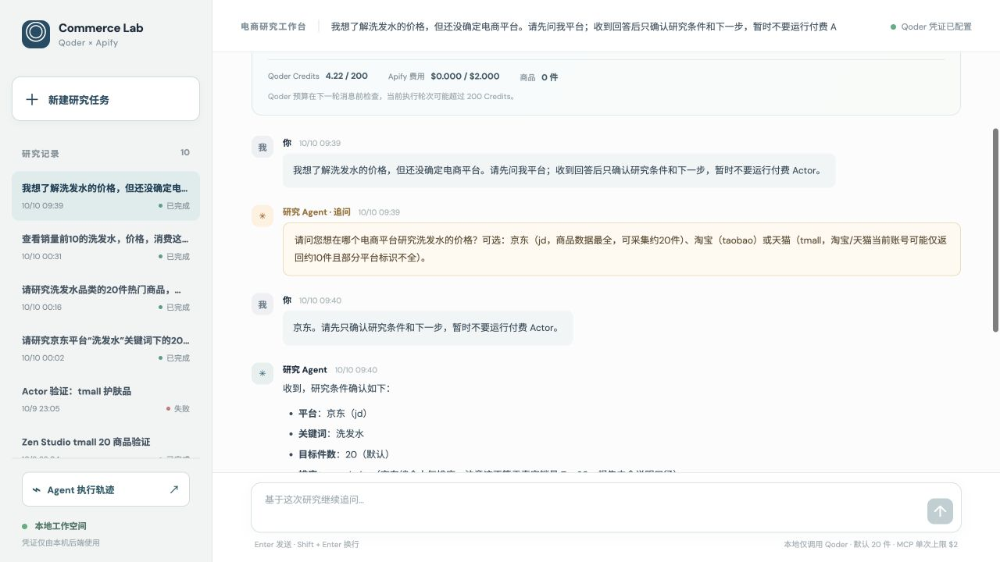
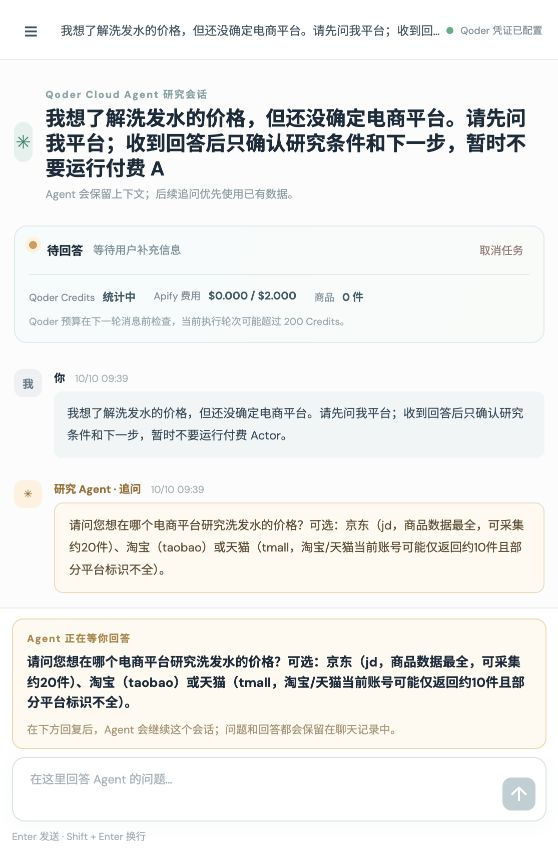
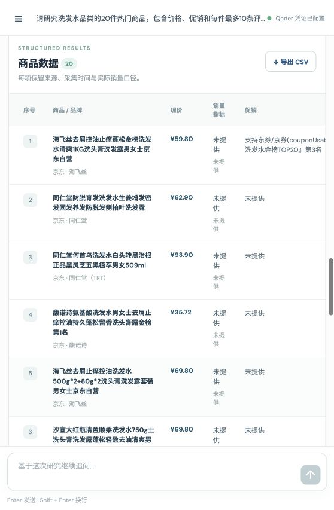
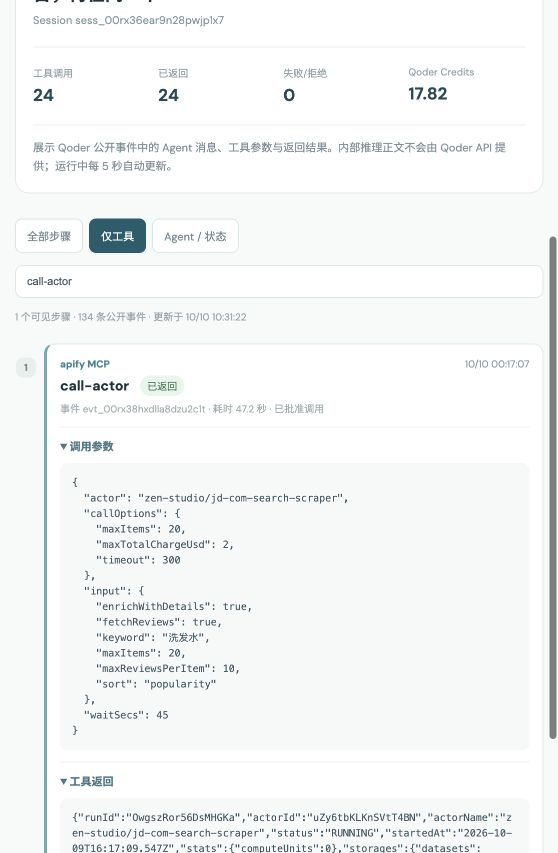

# Qoder Cloud Agent × Apify 电商研究台

一个仅在本机运行的电商研究 Web 应用。用户在聊天页描述平台、品类和字段；**Qoder Cloud Agent 在远端理解需求、追问、选择 Actor，并通过 Apify MCP 采集**。本地后端只调用 Qoder Cloud Agents API、保存结果和导出 CSV，**不直接请求 Apify API**。



[查看 12 秒演示视频](docs/media/demo.mp4) · [远端配置核验摘要](docs/media/qoder-config-verified.png) · [测试记录](docs/verification.md)

## 运行效果

- 聊天窗口：缺少平台时，Agent 在原 Session 中追问；等待期间问题固定在输入框上方，回答后问题和回复都保留。
- 采集结果：商品表、来源、排名依据、代表性评论、阶段进度、Qoder Credits 和 CSV 导出。
- 执行轨迹：左侧边栏底部打开独立页面，按 Session 查看 Agent 消息、MCP/自定义/内置工具调用、参数、返回、批准情况及耗时。

| 追问时 | 采集结果 | 远端 MCP 调用 |
| --- | --- | --- |
|  |  |  |

这些图片来自真实测试，但**不包含 PAT 或 Apify Token**。配置核验摘要由 Qoder Agent API 返回的非敏感字段制作，并非控制台截图。

## 第一次使用

需要 **Node.js 24+**、一个有可用 Credits 的 [Qoder Cloud Agents 个人空间](https://docs.qoder.com/cloud-agents/overview)，以及自己的 [Apify API Token](https://console.apify.com/settings/integrations)。Qoder PAT 可在控制台的 **Settings → Personal Access Tokens** 创建。使用自己的账号和 Token；仓库不附带作者的凭证。

```bash
git clone https://github.com/yiqi19940531/qoder-cloud-agent.git
cd qoder-cloud-agent
npm ci
cp .env.example .env.local
chmod 600 .env.local
```

只需在本机的 `.env.local` 填入两个值：

```dotenv
QODER_ACCESS_TOKEN=你的_Qoder_PAT
APIFY_API_TOKEN=你的_Apify_Token
```

随后运行：

```bash
npm run setup:qoder
npm run smoke:qoder
npm run smoke:mcp
npm run dev
```

打开 **http://127.0.0.1:3000**。`setup:qoder` 会自动选择当前账号可用的 Qwen3.8-Max（其次 Qwen3.8-Flash、`ultimate`），创建/更新 Agent 和云端 Environment，将 Apify Token 写入 Qoder Vault，配置远端 Apify MCP，再把所需 ID 写回 `.env.local`，**清空本地 `APIFY_API_TOKEN` 行**。两个 smoke 命令分别验证多轮交互和只读 MCP 连通性，不运行付费 Actor。若开发服务器在配置前已启动，请重启。

先用不会触发 Apify 付费运行的提问验证交互：

> 我想了解洗发水的价格，但还没确定平台。请先问我平台；收到回答后只确认需求，暂时不要采集。

确认配置无误后，再试完整采集：

> 研究京东洗发水热门商品前 20，整理价格、促销和评论，并说明排序是否代表真实销量。

完整采集会使用 Qoder Credits，并可能产生 Apify 费用。每个研究任务的远端 `call-actor` 设置不超过 **$2**，本应用目前每个任务只批准一次付费 Actor 调用。

## 它怎样工作

```text
浏览器 → 本机 Next.js API → Qoder Cloud Agent Session
                              ↓
                    已绑定 Qoder Vault 的 Apify MCP
                              ↓
                         Apify Actor / Dataset
                              ↓
              Agent 发布结构化结果 → 本机 SQLite / CSV
```

每个研究任务创建一个 Qoder Session，追问和后续问题复用这个 Session。后端接收 Qoder 事件历史与 SSE，在 `ask_user` 时等待网页回复，并用 `user.custom_tool_result` 恢复原任务。付费 `call-actor` 由 Qoder 请求确认；本地费用闸门校验 Actor、件数和 `maxTotalChargeUsd` 后决定是否批准。Agent 用远端 MCP 读取 Dataset，再调用 `publish_results` 交回本地保存。详情见 [远端配置与安全说明](docs/SETUP.md)。

## 成本、数据口径与当前限制

- **Qoder**：每个 Session 设置 200 Credits 预算。Qoder 在下一条用户消息进入时检查预算，运行中的一轮可能超过 200。
- **Apify**：单次 Actor 运行设置 `maxTotalChargeUsd=2`。当前 MCP 的 Run 返回未提供实际美元扣费，页面会显示“待 MCP 返回实际费用”，不会假设费用为 0。
- **销量**：京东 Actor 的 `popularity` 是搜索热度位置，**不是真实成交量 Top 20**。缺失价格、促销、评论等字段显示“未提供”。
- **平台**：京东已通过远端 MCP 实测 20 件；淘宝、天猫只有历史数据探查，当前账号可能只能返回 10 件且平台标识不全，远端完整验收仍待做。
- **轨迹**：Qoder API 提供公开工具事件和 Agent 消息；`agent.thinking` 不包含内部推理正文。长工具内容在页面截取展示，敏感字段被隐藏。
- **部署**：首版只监听 `127.0.0.1:3000`，无公网多用户认证。任务、结果和事件游标存于本机 `data/research.db`。

## 常用命令

```bash
npm test            # 单元测试
npm run typecheck   # TypeScript 检查
npm run build       # 生产构建
npm run start       # 本机生产服务（先 build）
```

`.env.local`、`data/`、`info.txt`、构建产物均在 `.gitignore` 中。不要把 PAT、Apify Token 或数据库复制到仓库。Token 轮换与远端 Vault 凭证维护见 [SETUP.md](docs/SETUP.md)。
