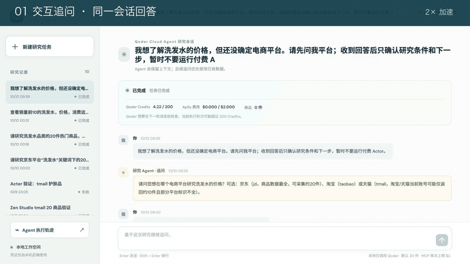
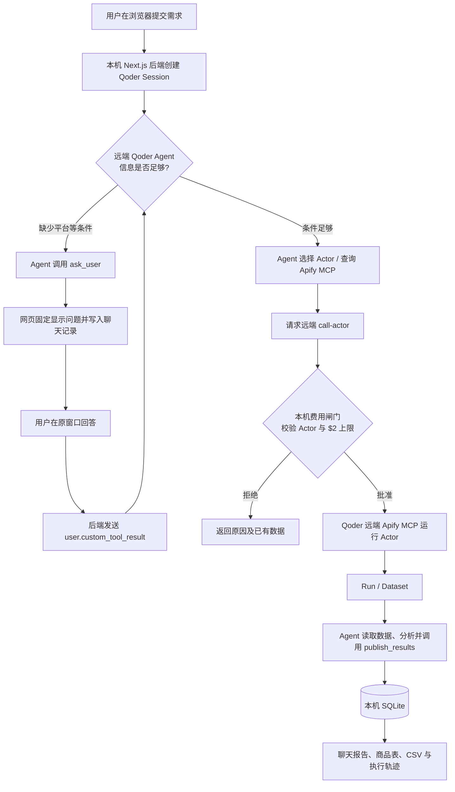

# Qoder Cloud Agent × Apify 电商研究台

一个在**本机运行**、由 **Qoder Cloud Agent 在远端执行**的电商商品研究应用。用户只需在聊天页描述想研究的平台、品类和字段；Agent 会澄清需求、选择 Actor、通过 Apify MCP 采集并分析，网页负责交互、显示进度、保存结果与导出 CSV。

**洗发水是本仓库的验收样例，不是写死的业务流程。** 用户可以换成其他品类关键词；平台与 Actor 能力由当前登记并实测的工具决定。首版重点验证京东，淘宝/天猫还有数据完整性限制，详见下文。

## 先看效果

下方演示可直接在 README 中观看；**点击画面可打开 MP4 文件**。画面依次展示聊天追问、回答留存、Agent 执行轨迹、远端 Apify MCP 调用，以及由 Qoder Agent API 核验的配置摘要。

[](docs/media/demo.mp4)

另外可查看 [测试截图](docs/media/README.md)、[20 商品表格](docs/media/03-products.png)、[MCP 调用参数](docs/media/09-actor-wide.png) 与 [测试记录](docs/verification.md)。配置摘要是依据 Qoder API 的非敏感字段制作的演示画面，**不是 Qoder 控制台截图**。

## 这个项目解决什么问题

传统采集脚本要求用户知道要用哪个 Actor、填写哪些输入参数，还要自行判断结果的销量口径。这里把这些判断交给远端 Agent：

- **自然语言输入**：例如“研究京东洗发水热门商品前 20，整理价格、促销和评论”。
- **必要时追问**：若缺少平台，Agent 通过 `ask_user` 在原聊天窗口提问；问题固定显示在输入框上方，回答与后续回复都保留在同一 Session。
- **远端工具选择与采集**：Agent 查询已登记 Actor，必要时搜索 Apify MCP；付费 `call-actor` 须经过本地费用闸门批准，然后由**远端 MCP**执行。
- **可核对的结果**：商品表保留价格、评论、来源、采集时间、排名依据、Run/Dataset 信息；页面可导出 CSV，不把搜索热度说成真实销量。
- **独立执行轨迹**：边栏底部打开新页面，按 Qoder Session 查看 Agent 公开消息、MCP/自定义/内置工具调用、参数、返回、批准结果及耗时。

浏览器和本机后端**不调用 Apify API，也不运行 Actor**。用户自己的 Apify Token 保存在 Qoder Vault 中，由绑定该 Vault 的 Cloud Agent 使用。

## 第一次运行：按顺序做

### 1. 准备账号与环境

- 安装 **Node.js 24+**。
- 在 [Qoder Cloud Agents](https://qoder.com/cloud/quickstart) 的**个人空间**准备可用 Credits，于 **Settings → Personal Access Tokens** 创建 PAT。网页登录状态不能代替 API PAT。
- 在 [Apify Integrations](https://console.apify.com/settings/integrations) 获取自己的 API Token，并确认账号可运行所选 Actor。

仓库**不附带作者的 PAT、Apify Token 或数据库**；新用户使用自己的账号和凭证。

### 2. 克隆并填写本机配置

```bash
git clone https://github.com/yiqi19940531/qoder-cloud-agent.git
cd qoder-cloud-agent
npm ci
cp .env.example .env.local
chmod 600 .env.local
```

仅编辑本机 `.env.local` 的这两行：

```dotenv
QODER_ACCESS_TOKEN=你的_Qoder_PAT
APIFY_API_TOKEN=你的_Apify_Token
```

其余 Agent、Environment、Vault ID 由配置脚本写入。`.env.local` 已被 Git 忽略。

### 3. 建立远端 Agent 并验证

```bash
npm run setup:qoder
npm run smoke:qoder
npm run smoke:mcp
npm run dev
```

打开 **http://127.0.0.1:3000**。`setup:qoder` 会选择账号可用的 Qwen3.8-Max（其次 Qwen3.8-Flash、`ultimate`），创建或更新 Agent、云端 Environment 与 Vault，并在 Agent 中配置 Apify MCP。它将 Apify Token 写入 Vault 后**清空本机 `APIFY_API_TOKEN` 行**；如果服务已经启动，需要重启服务来读取写回的 ID。两个 smoke 命令验证问答恢复与只读 MCP 连通，**不会运行付费 Actor**。

首次运行也可使用 `npm run build && npm run start` 启动生产服务；应用只监听 `127.0.0.1:3000`。远端配置细节、Token 轮换和排错见 [SETUP.md](docs/SETUP.md)。

## 实际测试过哪些流程

### 演示 A：不采集，先验证多轮对话

在聊天窗口输入：

> 我想了解洗发水的价格，但还没确定平台。请先问我平台；收到回答后只确认需求，暂时不要采集。

Agent 会在**同一个 Qoder Session** 中询问平台。回答“京东”后，页面保留“原问题 → 用户回答 → Agent 后续回复”；刷新后仍在。这个场景消耗少量 Qoder Credits，但不调用付费 Actor。截图见 [等待回答](docs/media/01-agent-question.png) 与 [回答留存](docs/media/07-answer-wide.png)。

### 演示 B：京东洗发水 20 件采集

输入：

> 研究京东洗发水热门商品前 20，整理价格、促销和评论，并说明排序是否代表真实销量。

在作者账号的验收中，Agent 通过远端 Apify MCP 运行 `zen-studio/jd-com-search-scraper`，返回 **20 件商品**，其中 **9 件**拿到了评论文本。结果页显示表格、来源与口径，并导出 **22 列 CSV**。`popularity` 是京东搜索热度位置，**不是真实成交量 Top 20**；缺失字段保留“未提供”，不补造。不同账号、时间和关键词可能返回不同结果或费用。

### 演示 C：检查工具调用与复用数据

在聊天页左侧边栏底部点击 **“Agent 执行轨迹”**，会在新标签页打开 `/activity`。20 商品测试 Session 的轨迹展示了 `ask_user`、Actor 查询、Apify MCP `call-actor`、Run/Dataset 读取、`publish_results` 等步骤；工具卡片可展开参数与返回。后续追问优先调用 `load_saved_data` 或读取原 Dataset，**不自动重复付费运行**。轨迹页运行中自动更新。

仓库只包含以上测试的**可公开截图和演示短片**；真实测试数据库属于本机运行数据，没有上传。新用户按前述配置即可用自己的账号重跑。

## 它怎样工作



**关键边界：**本地后端只调用 Qoder API；`call-actor` 真正由远端 Cloud Agent 的 Apify MCP 执行。本地负责确认一次付费运行是否符合预算、保存 Agent 发布的结果，以及接收 Qoder Session 事件历史与 SSE。每个研究任务对应一个 Session；本轮结束后的追问继续用原 Session。远端配置通过 Qoder Vault 注入密钥，浏览器拿不到 PAT 或 Apify Token。

## 数据、费用与支持范围

| 项目 | 当前行为 |
| --- | --- |
| 默认目标 | 20 件商品，每件评论最多 10 条；用户可在需求中指定件数。 |
| Apify 上限 | 每次远端 `call-actor` 设置 `maxTotalChargeUsd ≤ $2`；本应用目前每任务只批准一次付费调用。 |
| Qoder 预算 | 每个 Session 设置 200 Credits。Qoder 在下一条用户消息到来时检查预算，正在运行的一轮可能超过 200。 |
| 实际美元费用 | 当前 MCP Run 未返回精确扣费，页面显示“待 MCP 返回实际费用”，不把未知金额写成 0。 |
| 销量口径 | 真实成交量、页面文案、搜索排序与子榜单分别标注；京东 `popularity` 不能称为真实销量 Top 20。 |
| 平台 | 京东已由远端 MCP 实测 20 件。淘宝和天猫只有历史探查，当前账号可能仅返回 10 件且平台标识不完整，远端完整验收待做。 |
| 本地运行 | 只绑定回环地址；暂不支持公网多用户认证与数据隔离。任务保存在被 Git 忽略的 `data/research.db`。 |

Qoder 的公开 `agent.thinking` 事件只提供“推理中”标记，**不提供内部推理正文**。执行轨迹展示的是可公开的 Agent 消息与工具事件，不会编造隐藏推理。长工具返回在页面截取显示，可能包含的敏感字段会被隐藏。

## 项目文件与日常命令

| 路径 | 用途 |
| --- | --- |
| `scripts/setup-qoder.ts` | 创建/更新远端 Agent、Environment、Vault 和 MCP 配置。 |
| `src/lib/qoder.ts`、`src/lib/worker.ts` | Qoder API、事件流、工具批准、追问与结果处理。 |
| `src/lib/remote-mcp.ts` | 一次付费调用的参数与预算校验、结果来源校验。 |
| `src/app/page.tsx`、`src/app/activity/page.tsx` | 聊天页与独立执行轨迹页。 |
| `docs/SETUP.md`、`docs/verification.md` | 远端配置排错与作者账号测试记录。 |

```bash
npm test            # 自动化测试
npm run typecheck   # TypeScript 检查
npm run build       # 生产构建
npm run start       # 本机生产服务；先运行 build
```

`.env.local`、`data/`、`info.txt`、构建产物均在 `.gitignore` 中。Token 不应出现在 README、Issue、截图、录屏或 Git 提交里。如需轮换 Token，请看 [远端配置与安全说明](docs/SETUP.md)。
