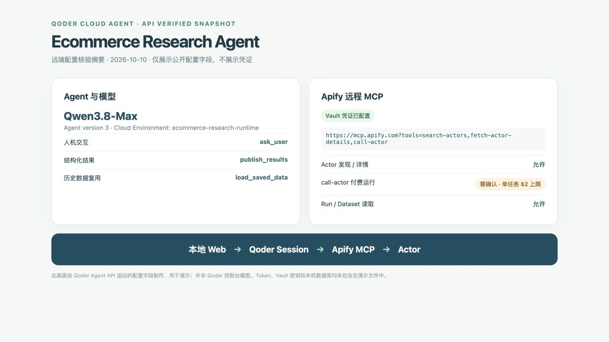

# 远端配置与交付说明

本文面向首次在自己账号中运行该项目的用户。完整命令见仓库根目录 [README](../README.md)。

## 1. 准备两个凭证

1. 在 [Qoder Cloud Agents](https://qoder.com/cloud/quickstart) 选择**个人空间**，于 **Settings → Personal Access Tokens** 创建 PAT。Qoder Cloud Agents API 使用这个 PAT；普通网页登录态不能替代 PAT。
2. 在 [Apify Integrations](https://console.apify.com/settings/integrations) 创建或复制自己的 API Token。
3. 将两个值仅写入本机 `.env.local` 的 `QODER_ACCESS_TOKEN` 和 `APIFY_API_TOKEN`。该文件已忽略提交，建议权限 `chmod 600 .env.local`。

不要把真实凭证放在 `.env.example`、README、Issue、截图、录屏、客户端代码或 Git 提交里。项目自带的是空白模板。

## 2. 一条命令建立远端 Agent

`npm run setup:qoder` 会通过 Qoder Cloud API 完成：

- 查询当前账号模型目录，依次选择 Qwen3.8-Max、Qwen3.8-Flash 或 `ultimate`。
- 创建或更新 `Ecommerce Research Agent` 和云端 `ecommerce-research-runtime` Environment。
- 创建或复用 `commerce-research-apify-mcp` Vault；把 Apify Token 作为 **static Bearer** 凭证保存到与下列 URL **精确匹配**的 MCP Server：

  ```text
  https://mcp.apify.com?tools=search-actors,fetch-actor-details,call-actor
  ```

- Agent 配置 Apify MCP 的 Actor 搜索、详情、`call-actor`、Run 与 Dataset 读取，以及 `ask_user`、`list_actors`、`load_saved_data`、`publish_results` 自定义工具。`call-actor` 的权限是 `always_ask`；本地后端审批后才会执行。
- 把 `QODER_AGENT_ID`、`QODER_ENVIRONMENT_ID`、`QODER_APIFY_VAULT_ID` 和就绪标记写回 `.env.local`，并清除本地 `APIFY_API_TOKEN` 行。

每次本地创建 Session 都会绑定该 Agent、Environment 和 Vault。**Vault 中的密钥不发送到浏览器**。如果已启动 Next.js，配置结束后重启它，以便读取新的环境变量。



这张图片是 API 核验摘要，**不是控制台截图**；真实配置以运行 `setup:qoder` 后自己的 Qoder 控制台为准。

## 3. 验证链路

```bash
npm run smoke:qoder   # 新建 Session，测试 ask_user 暂停/恢复；只消耗少量 Qoder Credits
npm run smoke:mcp     # 远端调用 Apify MCP 的只读 Actor 搜索；不运行付费 Actor
npm run dev           # 打开 http://127.0.0.1:3000
```

网页提交完整采集需求后，可从左侧边栏底部进入“Agent 执行轨迹”，查看当前 Session 的远端 MCP 调用和返回；聊天页展示商品、分析与 CSV 导出。

## 4. 费用和 Token 维护

- 默认 20 件商品、每件最多 10 条评论。每个任务创建一个 Qoder Session，预算为 200 Credits；这是 Qoder 的下一轮检查阈值，运行中的一轮可能超过。
- 远端 `call-actor` 的 `maxTotalChargeUsd` 不超过 $2。本应用在同一任务中只批准一次付费运行；因 MCP 当前未返回精确美元扣费，无法安全地在同一任务中追加第二次付费运行。
- 仅用已有数据的追问会先调用 `load_saved_data`，并可通过 MCP 读取原 Dataset，不自动重跑 Actor。
- 如 Apify Token 轮换或失效，先在 Qoder Vault 中移除/更新与上述 MCP URL 对应的旧凭证，再临时把新 Token 写入 `.env.local` 的 `APIFY_API_TOKEN`，重新运行 `npm run setup:qoder` 并重启本地服务。脚本以“该 URL 是否已有凭证”判断是否需要创建，**不会盲目覆盖已存在的 Vault 密钥**。
- PAT 到期时，在 Qoder 控制台生成新的项目 PAT，只更新本机 `.env.local` 并重启服务。

## 5. 常见问题

| 现象 | 先检查 |
| --- | --- |
| 页面提示 Qoder 尚未接入 | `.env.local` 的 PAT 是否有效，`setup:qoder` 是否成功，服务是否重启。 |
| 远端 MCP 授权失败 | Vault 是否含与 MCP URL 精确匹配的有效 Bearer 凭证，Session 是否绑定了 Vault。 |
| Agent 追问后没有继续 | 在原聊天窗口回复；后端会发送 `user.custom_tool_result`，原 Session 随后恢复。 |
| Actor 返回不足 20 件 | Actor/账号限制或搜索结果不足；页面展示实际数量，不补造商品。 |
| 实际 Apify 金额未知 | 当前 MCP Run 返回只有 computeUnits 等字段，页面如实显示“待 MCP 返回实际费用”；单次 $2 上限仍设置在远端调用参数。 |
| 内部推理正文看不到 | Qoder 的公开 `agent.thinking` 事件只给标记；执行轨迹可看 Agent 对外消息和工具调用，不会编造隐藏推理。 |

本项目只绑定本机回环地址，没有公网账号认证。若要部署给多人使用，需先增加用户认证、数据隔离、密钥托管和费用归属方案。
